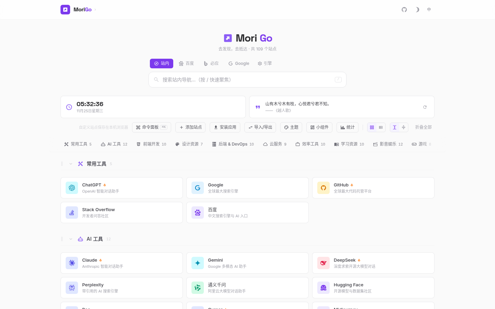
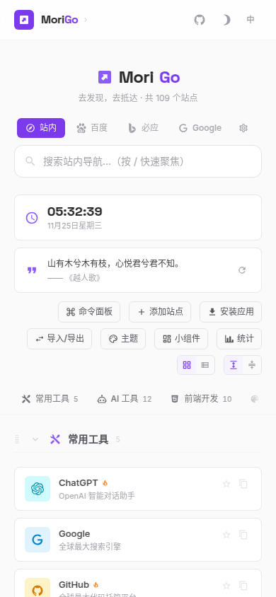

# MoriGo — Navigation Start Page

> Discover. Arrive.

[中文](./README.md) | **English** | [日本語](./README.ja.md)

A clean, modern, **open-source and self-hostable** navigation / start page, built with Vue 3 + TypeScript + Vite + TailwindCSS. Static only, no backend, no tracking — every preference and all of your personal data stay in your own browser.

🔗 **Live demo**: [go.morijiu.cn](https://go.morijiu.cn)

[](https://github.com/MoRijiu/morigo-guide-web/actions/workflows/ci.yml)

## 📸 Screenshots





## ✨ Features

### Search & discovery

- **Curated default data** — 12 categories and 109 sites (Common Tools / AI Tools / Frontend / Design Resources / Backend & DevOps / Cloud Services / Productivity / Learning / Media & Entertainment / Games / Shopping / Travel & Transport), all with search aliases (pinyin, short names, and translated names in Chinese, English and Japanese)
- **Smart search suggestions** — as you type: search history, completions, direct site matches and frequently visited sites, ranked by a multi-field score (title / aliases / domain / descriptions in three languages, boosted by favorites and visit counts), with keyword highlighting and full keyboard support
- **No dead ends** — when nothing matches on-site, continue with an external engine in one click, with popular sites recommended alongside
- **Custom search engines** — built-in on-site / Baidu / Bing / Google; add or remove your own engines (`{q}` template), your choice is remembered; search history can be cleared item by item or all at once

### Command palette

- `Ctrl/⌘ + K` opens it anywhere: fuzzy-search sites and run actions (switch theme, add a site, open panels, export, share…), fully keyboard-driven
- Press `?` or use the footer link to open the **shortcut help panel** — every shortcut on one page

### Favorites, stats & site health

- **Favorites & recent visits** — star favorites into a pinned group, recent visits are recorded automatically, copy any link in one click
- **Local stats panel** — total visits, visited-site and favorite counts, a top-sites chart and per-category share; computed entirely on-device, never reported, clearable in one click
- **Site health hints** — sites not opened for over 30 days are marked "Stale", and favorited-but-never-opened sites "Not opened yet", so you can tidy your list as you go; judged locally only, regular sites are never flagged

### Custom sites & categories

- **Add, edit and remove your own sites and categories** right on the page (persisted in localStorage), merged with the default data; new categories can pick an icon from a built-in library
- **Drag & drop everywhere** — reorder favorites and items inside custom categories, drag sites across categories, and reorder / pin / hide categories themselves; every order is persisted (pointer drag + `Alt+↑/↓` keyboard)
- **Card context menu** — right-click or long-press a card: open, copy link, favorite, edit, delete, move to another category
- **Automatic favicon fetch** — custom sites without an icon probe the target site's favicon automatically and fall back to an initial-letter tile; selected default sites probe on demand too

### Appearance & themes

- 6 accent colors, 5 gradient background presets, dark mode
- **Custom local image background** — upload an image (compressed automatically, stored in IndexedDB) with adjustable dim, blur and fixed/scroll behavior
- **Frosted glass** — one consistent rule for cards, the search box, widgets and every floating panel: translucent blur everywhere when on, solid everywhere when off
- Grid / list views, comfortable / compact density, collapsible categories — all preferences persisted

### Widgets

- An optional widget strip above the search box: **clock & date**, a **daily quote** (built-in local quote library), a **countdown** (editable target), and **weather** (Open-Meteo free API, off by default and only fetches when enabled, preset cities or browser geolocation, cached locally for 30 minutes)

### Data migration & cross-device sync

- **Import / export** — backup JSON export and import (merge / overwrite, validated before import), plus browser bookmark HTML import (auto-grouped by folder)
- **Share links** — your custom sites and favorites encoded into a URL (never sent to a server); the recipient previews first, then merges on confirm
- **Sync code** — all local data encoded into one checksummed text code; paste it on another device to restore everything. A **QR code** is shown next to it, and another device can **scan to import** right in the page (live camera or from an image); oversized data prompts you to use text or WebDAV instead
- **Passphrase encryption** — sync codes and WebDAV backups can be protected with a passphrase: PBKDF2 key derivation + AES-GCM, encrypted locally in the browser; the passphrase is never stored or uploaded
- **WebDAV sync** — enter your own WebDAV address to upload / download the sync file in one click; credentials are stored only on your device and never included in the synced data

### Trilingual interface

- 中文 / English / 日本語 — UI strings and the default navigation data (category names, site descriptions) are all trilingual, switchable from the header dropdown; the first visit follows your browser language, and missing translations fall back gracefully

### PWA, keyboard & accessibility

- **PWA** — installable to desktop / home screen, Service Worker offline cache, fully browsable offline with an offline indicator
- **Keyboard flow** — `/` focuses search, arrow keys move between cards, Enter opens, Esc clears layer by layer; shortcut help is always one key away
- **Accessibility** — skip link, aria labels, visible focus outlines

### Privacy & zero runtime dependencies

- Static only, no backend, no analytics; favorites, stats and custom data live only in your local browser
- Icons and fonts are bundled locally at build time — after deployment the page requests no third-party CDN and renders fully offline

## 🛠 Tech stack

| Tech | Notes |
|---|---|
| [Vue 3](https://vuejs.org) | Progressive frontend framework (Composition API + `<script setup>`) |
| [TypeScript](https://www.typescriptlang.org) | Type safety |
| [Vite](https://vitejs.dev) | Dev server & build |
| [TailwindCSS](https://tailwindcss.com) | Utility-first CSS |
| [Iconify](https://iconify.design) | Icon solution (registered locally at build time, no runtime requests) |
| @fontsource | Self-hosted Inter / Space Grotesk fonts |

## 📁 Project structure

```
src/
├── App.vue                # Main layout & global state orchestration
├── components/            # Header / search / categories / cards / context menu /
│                          #   command palette / theme / stats / widgets / data transfer / site form…
├── composables/           # Local state: favorites & stats, custom sites, view/theme prefs,
│                          #   search engines & history, PWA, custom background, weather, panel layout
├── config/
│   ├── site.ts            # Site config (brand, links, search engines, data assembly)
│   ├── navigation.ts      # Default navigation data (trilingual fields nameEn / nameJa / descriptionEn / descriptionJa)
│   └── navigation.local.example.ts  # Personal list example (see below)
├── i18n/                  # Chinese / English / Japanese string dictionaries & locale state
├── icons/                 # Locally registered icon set (generated by scripts/gen-icons.mjs)
├── utils/                 # Fuzzy matching & suggestions, data import/export, share links,
│                          #   sync code & encryption, WebDAV, site health, weather…
└── types/                 # TypeScript types
docs/                      # REQUIREMENTS.md, DESIGN.md, link-check report, screenshots
scripts/                   # gen-icons.mjs (icon generation), check-links.mjs (link check)
public/                    # Manifest, Service Worker, icons, robots.txt
```

## 🚀 Quick start

```bash
git clone https://github.com/MoRijiu/morigo-guide-web.git
cd morigo-guide-web

npm install          # Install dependencies
npm run dev          # Start the dev server
npm run build        # Production build (vue-tsc type check + vite build)
npm run preview      # Preview the production build
npm run check:links  # Link check: verify every default-data link, report to docs/LINK-CHECK.md
```

The build output lands in `dist/` — drop it on any static host (Nginx / Vercel / Netlify / Cloudflare Pages / GitHub Pages…) and you're live.

GitHub Actions are included: every PR and push to `main` runs type check + build and validates the output (`ci.yml`); the link check runs weekly and on demand in a separate workflow (`link-check.yml`, report only, never blocks merges).

## 🧩 Your own site list

The default data contains only generic example categories — none of the maintainer's private sites. To pin your own products / sites on top without touching the default data:

1. Copy `src/config/navigation.local.example.ts` to `src/config/navigation.local.ts` (already in `.gitignore`, never committed).
2. Replace the example categories with your own list (optional `nameEn` / `descriptionEn` English fields and `nameJa` / `descriptionJa` Japanese fields, with graceful fallback when omitted).
3. Rebuild: when the local list exists it is merged and pinned on top; when it doesn't, only the default data is shown.

So your fork / self-hosted copy opens with your list while the repository stays clean and generic. For a visitor-side temporary list, use the in-page "Add site" feature (stored in the browser), or move data between devices with import / export, share links and sync codes.

## ⚙️ Configuration

Edit `src/config/site.ts` to customize the whole site: brand name (`title` / `titleHighlight`), logo icon, domain and GitHub links, the search engine list and navigation data assembly all live there. UI strings such as the tagline live in the trilingual dictionaries under `src/i18n` (switched from the header language dropdown).

### Icon formats

Every `icon` field accepts several formats:

| Format | Example |
|---|---|
| Iconify | `"mdi:github"` |
| Remote URL | `"https://example.com/icon.png"` |
| Base64 | `"data:image/png;base64,..."` |
| Inline SVG | `"<svg>...</svg>"` |
| Local image | `"/icons/logo.png"` |

> Note: rendering uses the icon set registered locally at build time (`src/icons/localIcons.ts`, generated by `scripts/gen-icons.mjs` from the icon names used in the source). After adding a new icon name, run the generator once — or use an image URL instead. Custom sites without an icon automatically probe the target site's favicon and are not affected by this.

## 🚢 Deployment

It's a pure static site: run `npm run build` and publish `dist/` to any static host — no server-side setup required.

The version badge comes from `package.json`'s `version` (injected at build time): building with `VITE_APP_ENV=test` adds a `_test` suffix, `prod` shows the bare version, and the dev server shows `_dev`. See `docs/REQUIREMENTS.md` for the full convention.

## 📚 Development docs

- [docs/REQUIREMENTS.md](./docs/REQUIREMENTS.md) — product requirements & feature conventions (in Chinese)
- [docs/DESIGN.md](./docs/DESIGN.md) — visual & interaction design spec (in Chinese)
- [docs/LINK-CHECK.md](./docs/LINK-CHECK.md) — default-data link check report (generated by `npm run check:links`)

## 📄 License

[MIT](./LICENSE)
