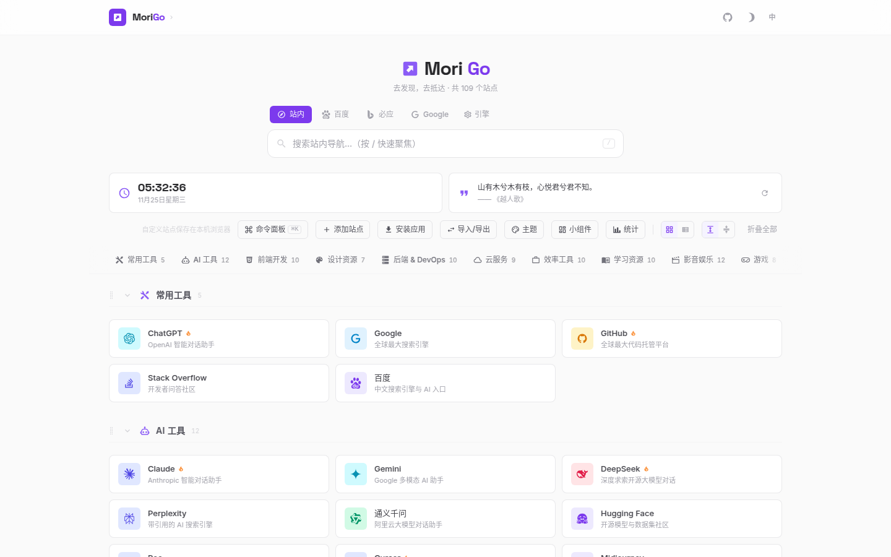
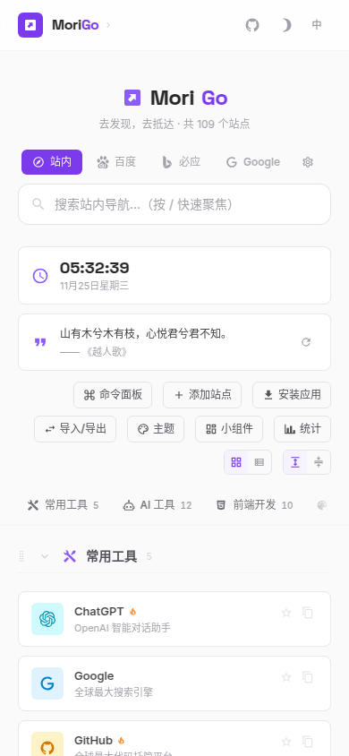

# MoriGo — ナビゲーション・スタートページ

> 発見して、たどり着く

[中文](./README.md) | [English](./README.en.md) | **日本語**

シンプルでモダンな、**オープンソースでセルフホスト可能な**ナビゲーションサイト／スタートページです。Vue 3 + TypeScript + Vite + TailwindCSS で構築されています。純粋な静的サイトで、バックエンドなし・トラッキングなし——設定も個人データも、すべてご自身のブラウザの中だけに保存されます。

🔗 **ライブデモ**：[go.morijiu.cn](https://go.morijiu.cn)

[](https://github.com/MoRijiu/morigo-guide-web/actions/workflows/ci.yml)

## 📸 スクリーンショット





## ✨ 特長

### 検索と発見

- **厳選されたデフォルトデータ** — 12 カテゴリ・109 サイト（よく使うツール / AI ツール / フロントエンド開発 / デザインリソース / バックエンド & DevOps / クラウドサービス / 効率化ツール / 学習リソース / 動画・エンタメ / ゲーム / ショッピング / 旅行・交通）を収録し、すべてのサイトに検索用エイリアス（ピンイン、略称、中・英・日の訳名）が付いています
- **スマートな検索候補** — 入力と同時に、検索履歴・補完候補・サイトへの直接マッチ・よく訪れるサイトを提示。多項目スコア（タイトル／エイリアス／ドメイン／3 言語の説明文にお気に入りと訪問回数を加味）で並べ替え、キーワードはハイライト表示、キーボードだけでも操作できます
- **見つからなくても行き止まりなし** — サイト内に該当がなければ、ワンクリックで外部エンジンに切り替えて検索を続けられます。人気サイトのおすすめも併せて表示します
- **カスタム検索エンジン** — サイト内／Baidu／Bing／Google を標準搭載。`{q}` テンプレートで独自エンジンの追加・削除もでき、選択は記憶されます。検索履歴は 1 件ずつの削除も一括クリアも可能です

### コマンドパレット

- `Ctrl/⌘ + K` でどこからでも呼び出せます。サイトのあいまい検索に加え、テーマ切替・サイト追加・各パネルの表示・エクスポート・共有などのアクションも実行でき、すべてキーボードで操作できます
- `?` キーまたはフッターのリンクから**ショートカットヘルプパネル**を開けます。全ショートカットを 1 ページで確認できます

### お気に入り・統計・サイトの状態表示

- **お気に入りと最近の訪問** — スターを付けたサイトは先頭のグループに固定され、最近訪れたサイトは自動で記録されます。リンクのコピーもワンクリックです
- **ローカル統計パネル** — 総訪問数・訪問済みサイト数・お気に入り数・訪問ランキング・カテゴリ別の割合を表示。すべて端末内で計算し、外部送信は一切ありません。ワンクリックで消去もできます
- **サイトの状態ヒント** — 30 日以上開いていないサイトには「久しく未訪問」、お気に入りに入れたのに一度も開いていないサイトには「未訪問」と表示され、リストの整理に役立ちます。判定はローカルのみで、通常のサイトに表示されることはありません

### カスタムサイトとカテゴリ

- ページ上で**自分のサイトとカテゴリを追加・編集・削除**できます（localStorage に保存）。デフォルトデータと統合して表示され、新しいカテゴリには用意されたアイコンライブラリからアイコンを選べます
- **あらゆる場所でドラッグ＆ドロップ** — お気に入りやカスタムカテゴリ内の並べ替え、カテゴリをまたいだサイトの移動、カテゴリ自体の並べ替え／ピン留め／非表示まで対応し、順序はすべて保存されます（ポインタ操作＋ `Alt+↑/↓` のキーボード操作）
- **カードのコンテキストメニュー** — カードを右クリックまたは長押しすると、開く／リンクをコピー／お気に入り／編集／削除／別カテゴリへ移動が選べます
- **favicon の自動取得** — アイコン未設定のカスタムサイトは、リンク先サイトの favicon を自動で取得し、失敗した場合は頭文字タイルにフォールバックします。一部のデフォルトサイトも必要に応じて取得します

### 外観とテーマ

- アクセントカラー 6 種、グラデーション背景プリセット 5 種、ダークモードを搭載しています
- **ローカル画像のカスタム背景** — 画像をアップロードすると自動圧縮して IndexedDB に保存。薄さ・ぼかし量・固定／スクロールを調整できます
- **すりガラス** — カード・検索ボックス・ウィジェット・すべてのフローティングパネルで口径を統一しました。オンなら全体が半透明＋ぼかし、オフなら全体が不透明になります
- グリッド／リスト表示、快適／コンパクトな密度、カテゴリの折りたたみなど、表示設定はすべて保存されます

### ウィジェット

- 検索ボックスの上に表示できるウィジェット帯（任意でオン／オフ）：**時計・日付**、**今日の一言**（内蔵のローカル名言ライブラリ）、**カウントダウン**（目標日を編集可能）、**天気**（Open-Meteo の無料 API。デフォルトはオフで、有効にしたときだけ通信します。プリセット都市またはブラウザの位置情報に対応し、30 分間ローカルにキャッシュします）

### データ移行とデバイス間同期

- **インポート／エクスポート** — バックアップ JSON の書き出しと読み込み（マージ／上書き、読み込み前に検証）に対応。ブラウザのブックマーク HTML のインポート（フォルダごとに自動分類）もできます
- **共有リンク** — カスタムサイトとお気に入りを URL にエンコードして共有します（サーバーを経由しません）。受け取った側はプレビューで確認してからマージできます
- **同期コード** — ローカルデータ全体を、チェックサム付きのテキストコードに変換します。別のデバイスに貼り付けるだけで丸ごと復元でき、生成時には**QR コード**も併せて表示し、別のデバイスではページ内で**スキャンしてインポート**できます（カメラのリアルタイム認識、または画像からの認識に対応。容量を超える場合はテキストまたは WebDAV の利用を案内します）
- **パスフレーズ暗号化** — 同期コードと WebDAV バックアップにはパスフレーズを設定できます。PBKDF2 で鍵を導出し、AES-GCM でブラウザ内暗号化します。パスフレーズ自体は保存も送信もされません
- **WebDAV 同期** — ご自身の WebDAV アドレスを入力すれば、同期ファイルのアップロード／ダウンロードがワンクリックで行えます。認証情報は端末内にのみ保存され、同期データには含まれません

### 3 言語インターフェース

- 中文／English／日本語 — UI の文言も、デフォルトのナビゲーションデータ（カテゴリ名・サイト説明）も 3 言語対応です。ヘッダーのドロップダウンで切り替えでき、初回訪問時はブラウザの言語に自動で合わせます。訳が未用意の項目は段階的にフォールバックします

### PWA・キーボード・アクセシビリティ

- **PWA** — デスクトップ／ホーム画面へインストールでき、Service Worker のオフラインキャッシュにより、通信がなくてもそのまま開いて閲覧できます。オフライン時にはその旨を表示します
- **キーボード操作** — `/` で検索にフォーカス、矢印キーでカード移動、Enter で開く、Esc で段階的にクリア。ショートカットヘルプもいつでも開けます
- **アクセシビリティ** — スキップリンク、aria ラベル、視認できるフォーカスアウトラインを備えています

### プライバシーとランタイム依存ゼロ

- 純粋な静的サイトで、バックエンドもアクセス解析もありません。お気に入り・統計・カスタムデータはすべてローカルのブラウザ内にのみ保存されます
- アイコンとフォントはビルド時にすべてローカルへ同梱します。デプロイ後は第三者の CDN へ一切リクエストせず、オフラインでも完全に描画できます

## 🛠 技術スタック

| 技術 | 説明 |
|---|---|
| [Vue 3](https://vuejs.org) | プログレッシブなフロントエンドフレームワーク（Composition API + `<script setup>`） |
| [TypeScript](https://www.typescriptlang.org) | 型安全性 |
| [Vite](https://vitejs.dev) | 開発サーバーとビルド |
| [TailwindCSS](https://tailwindcss.com) | ユーティリティファースト CSS |
| [Iconify](https://iconify.design) | アイコンの仕組み（ビルド時にローカル登録し、ランタイムのリクエストなし） |
| @fontsource | Inter / Space Grotesk フォントのセルフホスト |

## 📁 プロジェクト構成

```
src/
├── App.vue                # メインレイアウトと全体の状態管理
├── components/            # ヘッダー / 検索 / カテゴリ / カード / コンテキストメニュー /
│                          #   コマンドパレット / テーマ / 統計 / ウィジェット / データ移行 / サイトフォーム等
├── composables/           # ローカル状態：お気に入りと統計、カスタムサイト、表示/テーマ設定、
│                          #   検索エンジンと履歴、PWA、カスタム背景、天気、パネルレイアウト
├── config/
│   ├── site.ts            # サイト設定（ブランド、リンク、検索エンジン、データの組み立て）
│   ├── navigation.ts      # デフォルトのナビゲーションデータ（3 言語フィールド nameEn / nameJa / descriptionEn / descriptionJa）
│   └── navigation.local.example.ts  # 個人リストのサンプル（後述）
├── i18n/                  # 中・英・日の文言辞書と言語の状態
├── icons/                 # ローカル登録されたアイコンセット（scripts/gen-icons.mjs で生成）
├── utils/                 # あいまいマッチと検索候補、データのインポート/エクスポート、共有リンク、
│                          #   同期コードと暗号化、WebDAV、サイトの状態、天気 等
└── types/                 # TypeScript の型定義
docs/                      # REQUIREMENTS.md、DESIGN.md、リンクチェックレポート、スクリーンショット
scripts/                   # gen-icons.mjs（アイコン生成）、check-links.mjs（リンクチェック）
public/                    # manifest、Service Worker、アイコン、robots.txt
```

## 🚀 クイックスタート

```bash
git clone https://github.com/MoRijiu/morigo-guide-web.git
cd morigo-guide-web

npm install          # 依存関係をインストール
npm run dev          # 開発サーバーを起動
npm run build        # 本番ビルド（vue-tsc の型チェック + vite build）
npm run preview      # 本番ビルドをプレビュー
npm run check:links  # リンクチェック：デフォルトデータの全リンクを確認し、結果を docs/LINK-CHECK.md に出力
```

ビルド成果物は `dist/` に生成されます。任意の静的ホスティング（Nginx / Vercel / Netlify / Cloudflare Pages / GitHub Pages など）へ配置するだけで公開できます。

GitHub Actions も同梱しています。PR と `main` への push のたびに型チェック＋ビルドと成果物の検証が自動で走ります（`ci.yml`）。リンクチェックは週次と手動実行の別ワークフロー（`link-check.yml`）で、レポートのみでマージはブロックしません。

## 🧩 自分のサイトリストを使う

デフォルトデータには汎用的なサンプルカテゴリのみが含まれ、メンテナーの私的なサイトは含まれていません。デフォルトデータを書き換えずに、自分のプロダクト／サイトを先頭に固定するには：

1. `src/config/navigation.local.example.ts` を `src/config/navigation.local.ts` にコピーします（`.gitignore` 済みで、コミットされることはありません）。
2. サンプルのカテゴリをご自身のサイトリストに置き換えます（任意で `nameEn` / `descriptionEn` の英語フィールドと `nameJa` / `descriptionJa` の日本語フィールドを付けられ、省略時は段階的にフォールバックします）。
3. 再ビルドすると、ローカルリストがある場合は統合されて先頭に固定表示され、ない場合はデフォルトデータのみが表示されます。

これにより、fork／セルフホストしたご自身のトップページは自分のリストになり、リポジトリ自体はクリーンで汎用的なまま保てます。訪問者側の一時的なリストには、ページ内の「サイトを追加」機能（ブラウザに保存）や、インポート／エクスポート・共有リンク・同期コードによるデバイス間の移行が使えます。

## ⚙️ 設定

`src/config/site.ts` を編集するとサイト全体をカスタマイズできます。ブランド名（`title` / `titleHighlight`）、ロゴアイコン、ドメインと GitHub リンク、検索エンジンのリスト、ナビゲーションデータの組み立てはすべてここにあります。キャッチコピーなど UI の文言は `src/i18n` の 3 言語辞書で管理し、ヘッダーの言語ドロップダウンで切り替えます。

### アイコンの形式

すべての `icon` フィールドは複数の形式に対応しています：

| 形式 | 例 |
|---|---|
| Iconify | `"mdi:github"` |
| リモート URL | `"https://example.com/icon.png"` |
| Base64 | `"data:image/png;base64,..."` |
| インライン SVG | `"<svg>...</svg>"` |
| ローカル画像 | `"/icons/logo.png"` |

> 補足：実際の描画は、ビルド時にローカル登録されたアイコンセット（`src/icons/localIcons.ts`。ソース内で使われているアイコン名から `scripts/gen-icons.mjs` が生成します）を使います。新しいアイコン名を追加したら生成スクリプトを一度実行するか、画像 URL 形式を使ってください。アイコン未指定のカスタムサイトはリンク先の favicon を自動取得するため、この制約の影響を受けません。

## 🚢 デプロイ

純粋な静的サイトです。`npm run build` の後、`dist/` を任意の静的ホスティングへ公開するだけで、サーバー側の設定は不要です。

バージョンバッジは `package.json` の `version`（ビルド時に注入）から生成されます。`VITE_APP_ENV=test` でビルドすると `_test` サフィックスが付き、`prod` ではバージョンのみ、開発サーバーでは `_dev` と表示されます。詳細な取り決めは `docs/REQUIREMENTS.md` をご覧ください。

## 📚 開発ドキュメント

- [docs/REQUIREMENTS.md](./docs/REQUIREMENTS.md) — プロダクト要件と機能の取り決め（中国語）
- [docs/DESIGN.md](./docs/DESIGN.md) — ビジュアルとインタラクションのデザイン仕様（中国語）
- [docs/LINK-CHECK.md](./docs/LINK-CHECK.md) — デフォルトデータのリンクチェックレポート（`npm run check:links` で生成）

## 📄 License

[MIT](./LICENSE)
