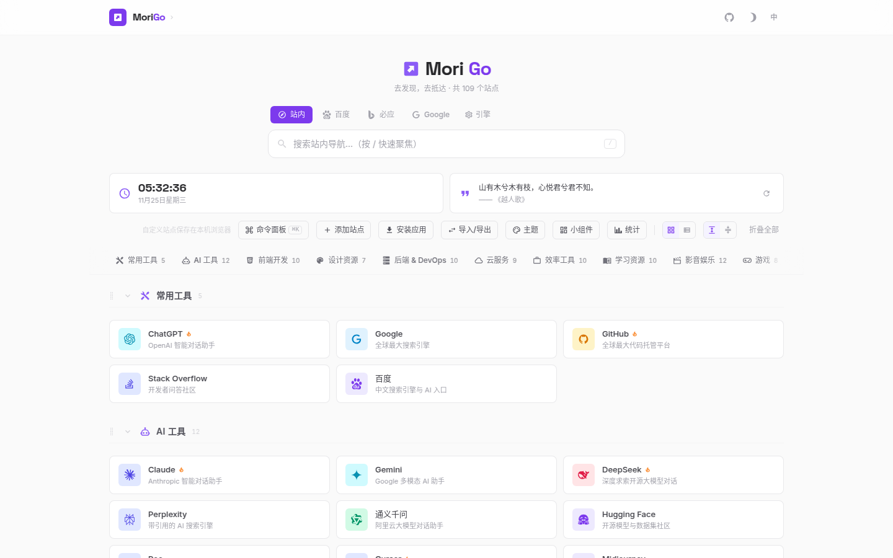
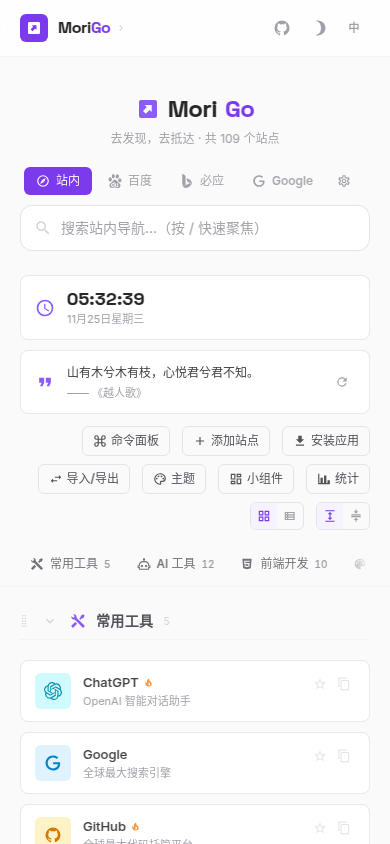

# MoriGo 导航站

> 去发现，去抵达

**中文** | [English](./README.en.md) | [日本語](./README.ja.md)

一个简洁、现代、**开源可自部署**的网址导航站 / 起始页，基于 Vue 3 + TypeScript + Vite + TailwindCSS 构建。纯静态、无后端、零追踪——所有偏好与个人数据只存在你自己的浏览器里。

🔗 **在线预览**：[go.morijiu.cn](https://go.morijiu.cn)

[](https://github.com/MoRijiu/morigo-guide-web/actions/workflows/ci.yml)

## 📸 截图





## ✨ 特性

### 搜索与发现

- **精选默认数据** — 12 大分类、109 个站点（常用工具 / AI 工具 / 前端开发 / 设计资源 / 后端 & DevOps / 云服务 / 效率工具 / 学习资源 / 影音娱乐 / 游戏 / 购物 / 旅行出行），全部带搜索别名（拼音、简称、中英日译名）
- **智能搜索建议** — 输入即出建议：搜索历史、补全词、站点直达、常访站点，多字段打分排序（标题 / 别名 / 域名 / 三语描述，叠加收藏与访问热度），关键词高亮、全键盘可达
- **无结果不卡壳** — 站内没找到时，一键用外部引擎继续搜，并推荐热门站点
- **自定义搜索引擎** — 内置站内 / 百度 / 必应 / Google，可增删自己的引擎（`{q}` 模板），选择会被记住；搜索历史可单条删除或清空

### 命令面板

- `Ctrl/⌘ + K` 全局呼出，模糊搜索站点 + 执行动作（切换主题、添加站点、打开各面板、导出、分享……），全程键盘操作
- 按 `?` 或从页脚打开**快捷键帮助面板**，全部快捷键一页看清

### 收藏、统计与健康标记

- **收藏与最近访问** — 星标收藏置顶成组、最近访问自动记录、一键复制链接
- **本地统计面板** — 总访问量、访问过的站点数、收藏数、访问 Top 榜、分类占比，纯本地计算、绝不上报，可一键清空
- **站点健康标记** — 超过 30 天没打开的站点显示「久未访问」，收藏了却从未打开的显示「未打开过」，帮你顺手清理清单；判断纯本地，普通站点不打扰

### 自定义站点与分类

- 页面里直接**增删改自己的站点与分类**（localStorage 持久化），与默认数据合并展示；新建分类可从预置图标库挑图标
- **拖拽无处不在** — 收藏与自定义分类内拖拽排序、站点跨分类拖拽搬家、分类本身也可拖拽排序 / 置顶 / 隐藏，顺序全部持久化（指针拖拽 + `Alt+↑/↓` 键盘）
- **卡片右键 / 长按菜单** — 打开、复制链接、收藏、编辑、删除、移动到其他分类
- **图标自动抓取** — 自定义站点没配图标时自动探测目标站的 favicon，失败回退字母色块；部分默认站点同样按需探测

### 外观与主题

- 6 套强调色、5 种渐变背景预设、深色模式
- **自定义本地图片背景** — 上传图片（自动压缩存 IndexedDB），淡化强度、模糊程度、固定 / 滚动可调
- **毛玻璃质感** — 卡片、搜索框、小组件与全部浮层面板统一口径：开则全站半透明模糊，关则全站实色
- 网格 / 列表视图、舒适 / 紧凑密度、分类折叠 / 展开，偏好全部持久化

### 小组件

- 搜索框上方可开关的组件带：**时钟 / 日期**、**每日一言**（本地语录库）、**倒计时**（目标可编辑）、**天气**（Open-Meteo 免费接口，默认关闭、开启才联网，预设城市或浏览器定位，本地缓存 30 分钟）

### 数据迁移与跨设备同步

- **导入 / 导出** — 备份 JSON 导出导入（合并 / 覆盖，导入前校验），导入浏览器书签 HTML（按文件夹自动分组）
- **分享链接** — 把自定义站点与收藏编码进 URL（不经任何服务器），对方打开先预览、确认后合并导入
- **同步码** — 全部本地数据编码为一段带校验的文本码，粘贴到另一台设备即可整表还原；生成后同屏展示**二维码**，另一台设备可直接在页面内**扫码导入**（相机实时识别或从图片识别），搬家更省事（超容量会提示改用文本或 WebDAV）
- **口令加密** — 同步码与 WebDAV 备份可加口令：PBKDF2 派生密钥 + AES-GCM 在浏览器本地加密，口令不保存、不上传
- **WebDAV 同步** — 填你自己的 WebDAV 地址即可一键上传 / 拉取同步文件；账号密码只存本机，不进同步数据

### 三语界面

- 中文 / English / 日本語：UI 文案与默认导航数据（分类名、站点描述）均三语，顶栏下拉切换，首次访问按浏览器语言自动选择，缺失译文逐级回退

### PWA、键盘与无障碍

- **PWA** — 可安装到桌面 / 主屏幕，Service Worker 离线缓存，断网照常打开浏览，离线状态有提示
- **键盘流** — `/` 聚焦搜索、方向键选卡、Enter 打开、Esc 分层清空，快捷键帮助面板随时查
- **无障碍** — skip link、aria 标签、focus 可见轮廓

### 隐私与零运行时依赖

- 纯静态、无后端、无统计上报；收藏、统计、自定义数据全部只存本地浏览器
- 图标与字体全部构建期本地打包，部署后不请求任何第三方 CDN，断网也能完整渲染

## 🛠 技术栈

| 技术 | 说明 |
|---|---|
| [Vue 3](https://vuejs.org) | 渐进式前端框架（Composition API + `<script setup>`） |
| [TypeScript](https://www.typescriptlang.org) | 类型安全 |
| [Vite](https://vitejs.dev) | 开发与构建 |
| [TailwindCSS](https://tailwindcss.com) | 原子化 CSS |
| [Iconify](https://iconify.design) | 图标方案（构建期本地注册，无运行时请求） |
| @fontsource | Inter / Space Grotesk 字体自托管 |

## 📁 项目结构

```
src/
├── App.vue                # 主布局与全局状态编排
├── components/            # 组件：顶栏 / 搜索 / 分类 / 卡片 / 右键菜单 / 命令面板 /
│                          #   主题 / 统计 / 小组件 / 导入导出 / 站点表单 等
├── composables/           # 本地状态：收藏与统计、自定义站点、视图/主题偏好、
│                          #   搜索引擎与历史、PWA、自定义背景、天气、面板布局
├── config/
│   ├── site.ts            # 站点配置（品牌、链接、搜索引擎、数据装配）
│   ├── navigation.ts      # 默认导航数据（三语字段 nameEn / nameJa / descriptionEn / descriptionJa）
│   └── navigation.local.example.ts  # 个人清单示例（见下）
├── i18n/                  # 中/英/日三语文案字典与语言状态
├── icons/                 # 本地注册的图标集（scripts/gen-icons.mjs 生成）
├── utils/                 # 模糊匹配与搜索建议、数据导入导出、分享链接、
│                          #   同步码与加密、WebDAV、站点健康、天气 等
└── types/                 # TypeScript 类型
docs/                      # 需求文档 REQUIREMENTS.md、设计规范 DESIGN.md、链接体检报告、截图
scripts/                   # gen-icons.mjs（图标生成）、check-links.mjs（链接体检）
public/                    # manifest、Service Worker、图标、robots.txt
```

## 🚀 快速开始

```bash
git clone https://github.com/MoRijiu/morigo-guide-web.git
cd morigo-guide-web

npm install          # 安装依赖
npm run dev          # 启动开发服务器
npm run build        # 构建生产版本（vue-tsc 类型检查 + vite build）
npm run preview      # 预览生产构建
npm run check:links  # 链接体检：检查默认数据全部链接可达性，报告写 docs/LINK-CHECK.md
```

构建产物在 `dist/`，丢到任何静态托管（Nginx / Vercel / Netlify / Cloudflare Pages / GitHub Pages…）即可上线。

仓库带 GitHub Actions：每个 PR 与 push 到 `main` 都会自动跑类型检查 + 构建并校验产物（`ci.yml`）；链接体检另有每周定时 + 手动触发的工作流（`link-check.yml`，只出报告不拦合并）。

## 🧩 放你自己的站点清单

仓库默认数据只包含通用示例分类，不包含任何维护者的私人站点。想把你自己的产品 / 站点置顶展示，不用改默认数据：

1. 复制 `src/config/navigation.local.example.ts` 为 `src/config/navigation.local.ts`（该文件已加入 `.gitignore`，不会被提交）。
2. 把里面的示例分类换成你自己的站点清单（可带 `nameEn` / `descriptionEn` 英文字段与 `nameJa` / `descriptionJa` 日文字段，缺省逐级回退）。
3. 重新构建：本地清单存在时会自动合并并置顶；不存在时只展示默认数据。

这样你 fork / 自部署时首页是你的清单，仓库本身保持干净通用。访客侧的临时清单则用页面内的「添加站点」功能（存浏览器本地），或用导入 / 导出、分享链接、同步码在设备间搬运。

## ⚙️ 配置说明

编辑 `src/config/site.ts` 即可自定义全站：品牌名（`title` / `titleHighlight`）、Logo 图标、域名与 GitHub 链接、搜索引擎列表、导航数据装配都在这里。界面副标题等文案走 `src/i18n` 三语字典（顶栏语言下拉切换）。

### 图标格式

所有 `icon` 字段支持多种格式：

| 格式 | 示例 |
|---|---|
| Iconify | `"mdi:github"` |
| 远程 URL | `"https://example.com/icon.png"` |
| Base64 | `"data:image/png;base64,..."` |
| 内联 SVG | `"<svg>...</svg>"` |
| 本地图片 | `"/icons/logo.png"` |

> 注意：运行时实际渲染走构建期本地注册的图标集（`src/icons/localIcons.ts`，由 `scripts/gen-icons.mjs` 按源码用到的图标名生成）；新增图标名后跑一次生成脚本，或改用图片 URL 格式。自定义站点未指定图标时会自动探测目标站 favicon，不受此限。

## 🚢 部署

纯静态站，`npm run build` 后把 `dist/` 发布到任意静态托管即可，无需任何服务端配置。

版本徽标取 `package.json` 的 `version`（构建注入）：构建时设 `VITE_APP_ENV=test` 时徽标加 `_test` 后缀，设为 `prod` 时为裸版本号，开发服务器显示 `_dev`，完整口径见 `docs/REQUIREMENTS.md`。

## 📚 开发文档

- [docs/REQUIREMENTS.md](./docs/REQUIREMENTS.md) — 产品需求与功能口径（中文）
- [docs/DESIGN.md](./docs/DESIGN.md) — 视觉与交互设计规范（中文）
- [docs/LINK-CHECK.md](./docs/LINK-CHECK.md) — 默认数据链接体检报告（`npm run check:links` 生成）

## 📄 License

[MIT](./LICENSE)
